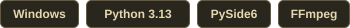
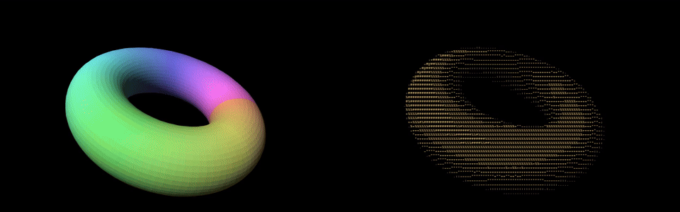
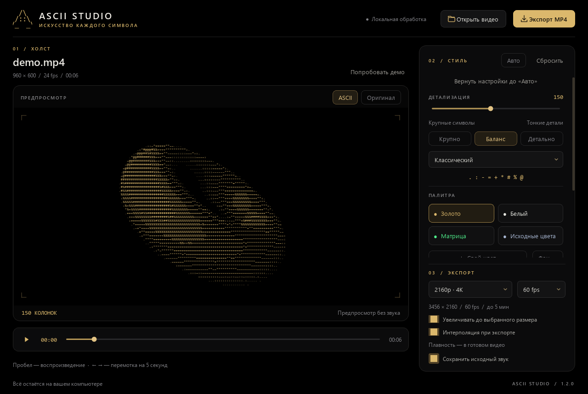

<div align="center">
  
  <h1>ASCII Studio</h1>
  <p><strong>Превратите видео в движущуюся картину из символов.</strong></p>
  <p>Выберите палитру, настройте детализацию и сохраните MP4 со звуком.</p>
  
  <p><a href="#start">Запуск</a> · <a href="#features">Возможности</a> · <a href="docs/guide.md">Настройки и управление</a> · <a href="#development">Разработка</a></p>
</div>



<p align="center"><sub>Слева — встроенный деморолик. Справа — результат экспорта в золотой палитре.</sub></p>

<a id="features"></a>

## Возможности

| Инструмент | Возможности |
| --- | --- |
| **Настройка изображения** | Детализация от 40 до 280 колонок, четыре набора символов, контраст, яркость и контуры. |
| **Палитры** | Золото, белый, зелёная «Матрица», исходные цвета и собственный цвет символов и фона. |
| **Автоматический подбор** | Анализ нескольких кадров для настройки контраста, яркости и контуров с возможностью отмены. |
| **Предпросмотр** | Воспроизведение, перемотка и переключение между исходником и ASCII. |
| **Экспорт** | MP4 с H.264 и AAC, разрешение до 4K UHD, частота до 240 FPS, сохранение ориентации. |
| **Движение** | Повышение FPS с интерполяцией на основе оценки движения и увеличение разрешения с повторной отрисовкой символов. |

> [!NOTE]
> Видео обрабатывается локально. Максимальная длительность одного ролика — 5 минут.



<a id="start"></a>

## Запуск в Windows

Нужны Python 3.13 x64 и интернет для установки зависимостей. Скачайте репозиторий через **Code → Download ZIP**, распакуйте архив и запустите **setup.bat**. После установки открывайте приложение через **run.bat**.

Те же действия можно выполнить в PowerShell из папки проекта.

```powershell
py -3.13 -m venv .venv
.\.venv\Scripts\python.exe -m pip install -r requirements.txt
.\.venv\Scripts\python.exe main.py
```

1. Нажмите **Попробовать демо** или **Открыть видео**. Файл также можно перетащить в окно.
2. Настройте детализацию и палитру. Кнопка **Авто** подберёт параметры изображения.
3. Нажмите **Экспорт MP4**, выберите место сохранения и дождитесь завершения.

Предпросмотр воспроизводится без звука. Экспорт может включать первую аудиодорожку исходника. Встроенный шестисекундный ролик создан процедурно, его можно сразу использовать для знакомства с приложением.

## Параметры экспорта

4K UHD ограничивает горизонтальный кадр размерами 3840 × 2160, вертикальный — 2160 × 3840. Пропорции сохраняются. Увеличение небольших исходников и интерполяция включаются отдельно.

Рендер выполняется на CPU. Разрешение и FPS задают параметры выходного файла, а скорость обработки зависит от компьютера и настроек. Интерполяция применяется при экспорте и может давать искажения на сложном движении. Экспорт можно отменить.

Подробности о палитрах, автонастройке, горячих клавишах и ограничениях собраны в [руководстве](docs/guide.md).

<a id="development"></a>

## Разработка и проверка

| Файл или папка | Назначение |
| --- | --- |
| `main.py` | Запуск приложения и диагностический режим |
| `ascii_studio/engine.py` | Чтение видео, отрисовка ASCII и экспорт через FFmpeg |
| `ascii_studio/window.py` | Интерфейс, предпросмотр и управление обработкой |
| `ascii_studio/autotune.py` | Автоматический подбор параметров изображения |
| `tests/` | Проверки обработки, улучшений изображения и ограничений экспорта |
| `scripts/build.ps1` | Сборка Windows-приложения через PyInstaller |

```powershell
.\.venv\Scripts\python.exe -m pip install -r requirements-dev.txt
.\.venv\Scripts\python.exe -m pytest -q
.\.venv\Scripts\python.exe main.py --smoke-test-dir test-output\source
```

Диагностический режим проверяет интерфейс, встроенное демо, автонастройку, экспорт со звуком, 4K / 240 FPS и ограничение длительности. В выбранную папку сохраняются `report.json`, скриншоты окна и тестовые видео.

## Сборка приложения

```powershell
.\scripts\build.ps1
```

Готовая программа появится в `dist/1.2.0/ASCII Studio/`. Для переноса используйте папку целиком вместе с `_internal`. Сборка включает Python, Qt и FFmpeg, а также сведения о сторонних компонентах.

Список зависимостей и сведения о демоматериалах доступны в [THIRD_PARTY.md](THIRD_PARTY.md).
